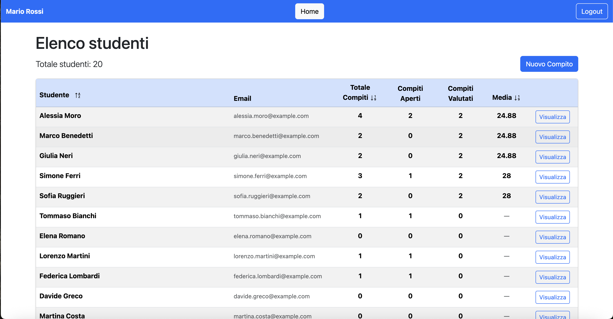
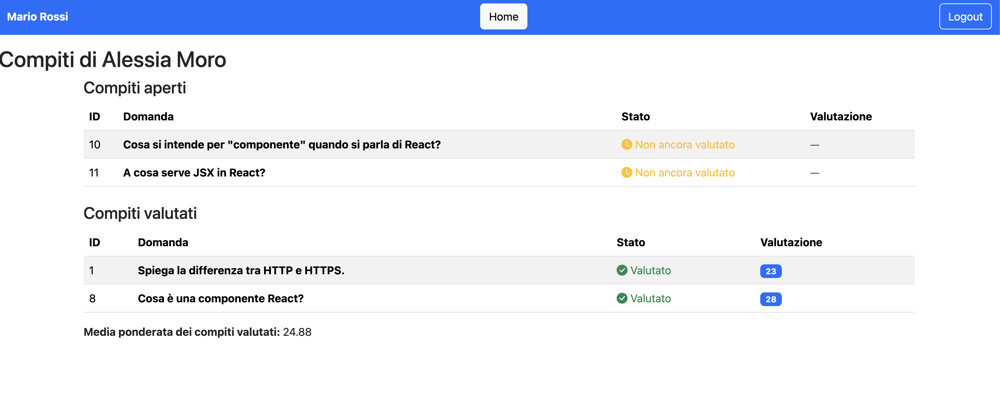
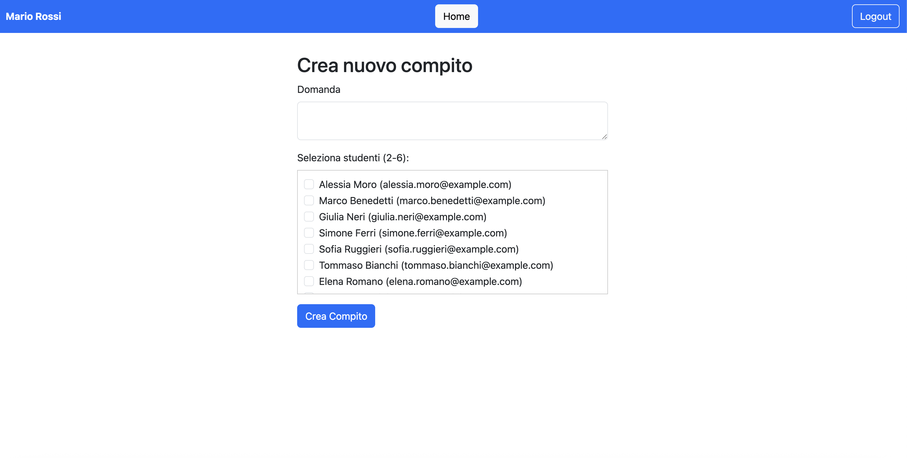
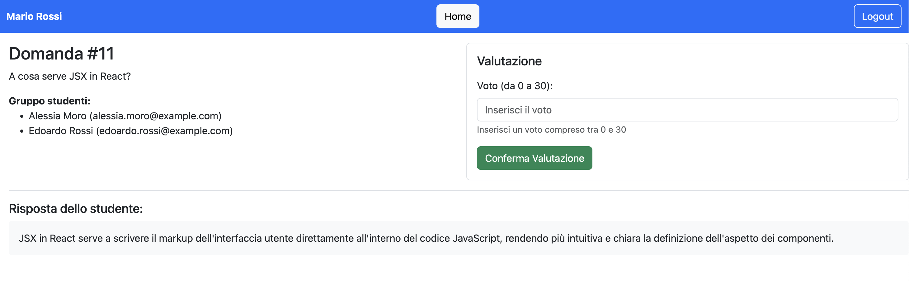
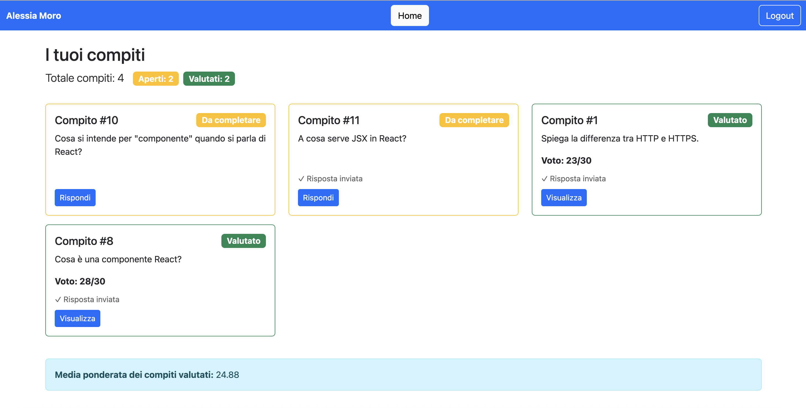
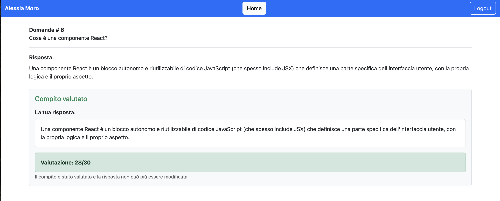
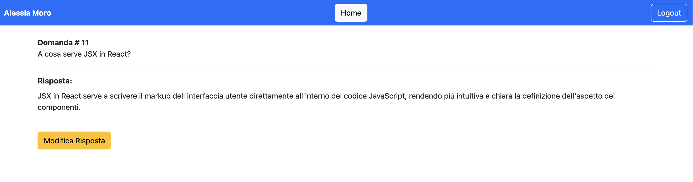

[](https://classroom.github.com/a/F9jR7G97)
# Exam #2: "Compiti"
## Student: s348487 MANOCCHIO GIUSEPPE 

## React Client Application Routes

### `/`
**Home page**  
Pagina di benvenuto con link al login.

---

### `/login`
**Login**  
Form di autenticazione per docenti e studenti.

---

### `/studenti/compiti`
**Home studente**  
Visualizza tutti i compiti assegnati allo studente autenticato, divisi tra aperti e valutati, con la media ponderata.

---

### `/studenti/compiti/:id`
**Dettaglio compito studente**  
Visualizza i dettagli di un singolo compito per lo studente, la domanda, la risposta e lo stato di valutazione.

---

### `/studenti/compiti/:id/risposta`
**Risposta compito**  
Permette allo studente di inserire o modificare la risposta al compito selezionato (solo se non ancora valutato).

---

### `/docenti/studenti`
**Home docente**  
Visualizza la lista di tutti gli studenti e permette di accedere ai loro compiti o creare un nuovo compito.

---

### `/docenti/compiti/nuovo`
**Nuovo compito**  
Form per la creazione di un nuovo compito e selezione del gruppo di studenti (da 2 a 6).

---

### `/docenti/studenti/:id/compiti`
**Compiti di uno studente (vista docente)**  
Visualizza tutti i compiti assegnati dal docente allo studente selezionato, divisi tra aperti e valutati, con la media ponderata.

---

### `/docenti/studenti/:id/compiti/:id`
**Valutazione compito**  
Permette al docente di visualizzare la risposta dello studente e inserire la valutazione del compito.

---

### `*`
**Pagina non trovata**  
Visualizzata per tutte le route non riconosciute.


## API Server

Qui di seguito sono riportate le principali HTTP API implementate nel progetto.

---

### __Login__

URL: `/api/sessions`  
HTTP Method: POST  
Description: Effettua il login di un utente (studente o docente).

Request body:
```
{
  "username": "mario.rossi@example.com",
  "password": "password"
}
```

Response: `200 OK` (successo) o `401 Unauthorized` (credenziali errate).  
Response body (successo):
```
{
  "UserId": 1,
  "Email": "mario.rossi@example.com",
  "Nome": "Mario",
  "Cognome": "Rossi",
  "Ruolo": "docente"
}
```

---

### __Logout__

URL: `/api/sessions/current`  
HTTP Method: DELETE  
Description: Effettua il logout dell’utente autenticato.

Response: `200 OK` (successo).

---

### __Verifica sessione corrente__

URL: `/api/sessions/current`  
HTTP Method: GET  
Description: Restituisce i dati dell’utente autenticato, se presente.

Response: `200 OK` (successo) o `401 Unauthorized` (non autenticato).  
Response body (successo): come login.

---

### __Crea nuovo compito (docente)__

URL: `/api/docenti/compiti`  
HTTP Method: POST  
Description: Crea un nuovo compito per un gruppo di studenti.

Request body:
```
{
  "domanda": "Spiega la differenza tra HTTP e HTTPS.",
  "idstudenti": [3, 4, 5]
}
```

Response: `201 Created` (successo) o `422 Unprocessable Entity` (parametri errati).

---

### __Lista compiti di uno studente per docente__

URL: `/api/docenti/studenti/:id/compiti`  
HTTP Method: GET  
Description: Restituisce tutti i compiti assegnati dal docente allo studente specificato.

Response: `200 OK`  
Response body:
```
[
  {
    "Id": 1,
    "Domanda": "Spiega la differenza tra HTTP e HTTPS.",
    "IdProfessore": 1,
    "IdStudenti": "[3,4,5]",
    "Risposta": null,
    "Completato": 0,
    "Valutato": 0,
    "Valutazione": null
  },
  ...
]
```

---

### __Lista compiti aperti per studente__

URL: `/api/studenti/compiti/aperti`  
HTTP Method: GET  
Description: Restituisce tutti i compiti non ancora valutati a cui partecipa lo studente autenticato.

Response: `200 OK`  
Response body: array di compiti (come sopra).

---

### __Lista compiti valutati per studente__

URL: `/api/studenti/compiti/valutati`  
HTTP Method: GET  
Description: Restituisce tutti i compiti già valutati a cui partecipa lo studente autenticato.

Response: `200 OK`  
Response body: array di compiti (come sopra).

---

### __Invia risposta a un compito (studente)__

URL: `/api/studenti/compiti/:id/risposta`  
HTTP Method: PUT  
Description: Invia la risposta al compito specificato.

Request body:
```
{
  "risposta": "La risposta dello studente..."
}
```

Response: `200 OK` (successo) o `422 Unprocessable Entity` (parametri errati).

---

### __Valuta un compito (docente)__

URL: `/api/docenti/compiti/:id/valutazione`  
HTTP Method: PUT  
Description: Inserisce la valutazione per il compito specificato.

Request body:
```
{
  "voto": 28
}
```

Response: `200 OK` (successo) o `422 Unprocessable Entity` (parametri errati).

---

### __Ottieni un compito per id__

URL: `/api/compiti/:id`  
HTTP Method: GET  
Description: Restituisce i dettagli di un compito dato il suo id.

Response: `200 OK`  
Response body:
```
{
  "Id": 1,
  "Domanda": "Spiega la differenza tra HTTP e HTTPS.",
  "IdProfessore": 1,
  "IdStudenti": "[3,4,5]",
  "Risposta": null,
  "Completato": 0,
  "Valutato": 0,
  "Valutazione": null
}
```

---

### __Lista di tutti gli studenti (docente)__

URL: `/api/docenti/studenti`  
HTTP Method: GET  
Description: Restituisce la lista di tutti gli studenti.

Response: `200 OK`  
Response body:
```
[
  {
    "UserId": 3,
    "Email": "alessia.moro@example.com",
    "Nome": "Alessia",
    "Cognome": "Moro",
    "Ruolo": "studente"
  },
  ...
]
```

## Database Tables

### `utenti`
Tabella che contiene le informazioni sugli utenti (studenti e docenti).

| Colonna     | Tipo     | Descrizione                |
|-------------|----------|----------------------------|
| userid      | String   | Identificativo univoco     |
| email       | String   | Email dell’utente          |
| nome        | String   | Nome                       |
| cognome     | String   | Cognome                    |
| salt        | String   | salt usato per l'hashing   |
| password    | String   | Password (hashata)         |
| ruolo       | String   | Ruolo (`studente`/`docente`)|

---

### `compiti`
Tabella che contiene i compiti assegnati agli studenti.

| Colonna        | Tipo           | Descrizione                                 |
|----------------|----------------|---------------------------------------------|
| id             | String         | Identificativo univoco del compito          |
| domanda        | String         | Testo della domanda                         |
| risposta       | String         | Risposta fornita dallo studente             |
| idprofessore   | String         | ID del docente assegnante                   |
| idstudenti     | Array di String| ID degli studenti assegnati (gruppo)        |
| completato     | Boolean        | Indica se il compito è stato completato     |
| valutato       | Boolean        | Indica se il compito è stato valutato       |
| valutazione    | Integer        | Indica la valutazione del compito.          |

## Main React Components

- `App` (in `App.jsx`): Gestisce il routing principale dell’applicazione e lo stato globale di autenticazione e utente.
- `HomeApp` (in `components/HomeApp.jsx`): Pagina di benvenuto iniziale con link al login.
- `Login` (in `components/Login.jsx`): Form di autenticazione per docenti e studenti.
- `NavHeader` (in `components/NavHeader.jsx`): Barra di navigazione superiore con nome utente, pulsante home e logout.
- `HomeStudente` (in `components/Vista_Studente/HomeStudente.jsx`): Home dello studente, mostra i compiti assegnati, lo stato e la media.
- `CompitoStudente` (in `components/Vista_Studente/CompitoStudente.jsx`): Pagina di dettaglio di un singolo compito per lo studente.
- `CompitoDescription` (in `components/Vista_Studente/CompitoDescription.jsx`): Mostra la domanda, la risposta e il form per rispondere a un compito.
- `RispostaForm` (in `components/Vista_Studente/RispostaForm.jsx`): Form per inserire o modificare la risposta a un compito.
- `HomeDocente` (in `components/Vista_Docente/HomeDocente.jsx`): Home del docente, mostra la lista degli studenti e permette di creare nuovi compiti.
- `FormNuovoCompito` (in `components/Vista_Docente/FormNuovoCompito.jsx`): Form per la creazione di un nuovo compito e selezione del gruppo di studenti.
- `CompitiStudente` (in `components/Vista_Docente/CompitiStudente.jsx`): Mostra tutti i compiti di uno studente (vista docente), divisi tra aperti e valutati.
- `ValutazionePage` (in `components/Vista_Docente/ValutazionePage.jsx`): Pagina per la valutazione di un compito da parte del docente.


## Screenshot









## Users Credentials
Ho utilizzato per semplicità password come password per tutti gli utenti, sia docenti che studenti.
### Docenti
- mario.rossi@example.com, password
- lucia.verdi@example.com, password

### Studenti
- alessia.moro@example.com, password
- marco.benedetti@example.com, password
- giulia.neri@example.com, password
- simone.ferri@example.com, password
- sofia.ruggieri@example.com, password
- tommaso.bianchi@example.com, password
- elena.romano@example.com, password
- lorenzo.martini@example.com, password
- federica.lombardi@example.com, password
- davide.greco@example.com, password
- martina.costa@example.com, password
- andrea.fontana@example.com, password
- chiara.leone@example.com, password
- francesco.mancini@example.com, password
- sara.russo@example.com, password
- luca.coppola@example.com, password
- valentina.grassi@example.com, password
- edoardo.rossi@example.com, password
- marta.bruno@example.com, password
- gabriele.deangelis@example.com, password
